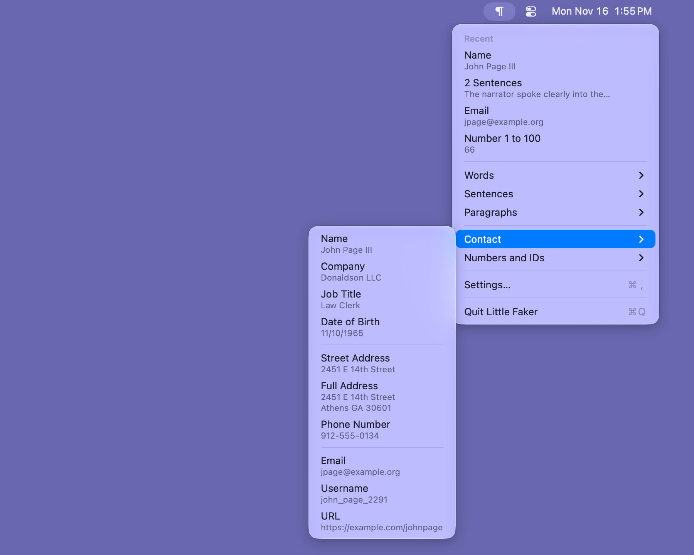

# Little Faker website

[https://littlefaker.gshaw.ca](https://littlefaker.gshaw.ca)



## Develop

```sh
mise install       # Hugo, Node, cspell, markdownlint, lychee, wrangler
mise run dev       # https://lf.dev.gshaw.ca with live reload
mise run check     # build, spell check, markdown lint, internal links
```

Deploy with `mise run deploy`. It refuses unless you're on a clean `main` with nothing newer on GitHub, then checks, pushes, waits for Workers Builds and runs `mise run verify`. `mise run deploy-status` says whether `main` is live. The rule is in [Workshop's deploy note](https://github.com/gshaw/Workshop/blob/main/Tooling/deploy.md).

## Powered By

- DNS: [Cloudflare DNS](https://www.cloudflare.com/dns/)
- Hosting: [Cloudflare Workers](https://workers.cloudflare.com), static assets, built by Workers Builds
- Build System: [Hugo](https://gohugo.io)
- CSS: [Pico.css](https://picocss.com)
